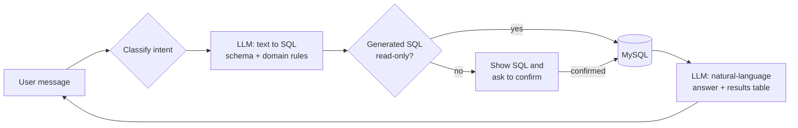

# ChatCRM: an AI-native, natural-language CRM

   

ChatCRM lets sales and account teams work with a CRM database by typing what they want in plain language, without needing to know SQL. A request like *"Find our customers in Guangdong"* or *"I called Zhang San today and he's interested in the new product"* is turned into SQL by an LLM, checked for safety, executed against MySQL, and answered in natural language with a results table.

The system was built for a Chinese-language CRM, so its LLM prompts, UI, and business rules are in Chinese. It also accepts English requests.

## Highlights

- **Text-to-SQL with live schema grounding.** The database schema is introspected at startup (`SHOW TABLES` / `DESCRIBE`) and injected into the prompt, so the model writes SQL against the real tables and columns.
- **Domain-aware prompting.** Rules for CRM workflows, such as turning a sentence describing a phone call into an `INSERT` into the communication-records table, with subqueries to resolve customer IDs.
- **Geographic query expansion.** Province-level requests (for example "customers in Jiangsu") are expanded to the province's cities, because the CRM stores city-level locations.
- **Human-in-the-loop safety.** Read-only queries run immediately. Any `INSERT`, `UPDATE`, or `DELETE` shows the generated SQL and requires explicit confirmation. The decision is based on the *generated SQL* itself, not only on keywords in the request.
- **Resilient LLM layer.** Retries with increasing back-off and timeouts, a secondary `requests`-based client if the OpenAI SDK path fails, and a rule-based SQL generator for common requests if the API is unavailable.
- **Two interfaces, one core.** A colorized terminal app and a real-time web chat (Flask + Socket.IO) share the same database, auth, and LLM modules.
- **Natural-language answers.** Query results are summarized back to the user by the LLM, alongside a formatted table and affected-row counts.

## How it works



| Layer | File | Responsibility |
|---|---|---|
| Configuration | `config.py` | Reads database, LLM, and app settings from environment variables |
| Data access | `database.py` | MySQL connection, schema introspection, query execution, SQL operation classification |
| AI service | `llm_service.py` | Text-to-SQL prompt, retries and timeouts, geographic expansion, result explanation |
| AI fallback | `llm_service_fallback.py` | Alternative HTTP client used when the SDK client cannot be initialized |
| Authentication | `auth.py` | Login against the `user` table with parameterized queries |
| CLI | `main.py` | Terminal interface |
| Web | `app.py`, `templates/`, `static/` | Flask REST endpoints + Socket.IO chat with a confirmation dialog |

More detail: [Architecture](docs/ARCHITECTURE.md) · [Database setup](docs/DATABASE_SETUP.md) · [Query execution rules](docs/QUERY_EXECUTION.md) · [Troubleshooting](docs/TROUBLESHOOTING.md)

## Getting started

**Requirements:** Python 3.8+, a MySQL database, and a [DeepSeek API key](https://platform.deepseek.com/) (any OpenAI-compatible endpoint also works through `DEEPSEEK_BASE_URL`).

```bash
git clone https://github.com/felixliu878/ChatCRM.git
cd ChatCRM
pip install -r requirements.txt

cp .env.example .env   # then fill in your database and API credentials
```

Create the tables described in [docs/DATABASE_SETUP.md](docs/DATABASE_SETUP.md), then start either interface:

```bash
python start_web.py    # web chat at http://localhost:5001
python main.py         # terminal interface
```

## Example requests

| Request (as typed) | Meaning | What happens |
|---|---|---|
| 显示所有客户 | Show all customers | `SELECT`, runs immediately |
| 查找广东的客户 | Find customers in Guangdong | `SELECT … WHERE city IN (广州, 深圳, …)` |
| 统计每个城市的客户数量 | Count customers per city | `GROUP BY` aggregate |
| 添加新客户张三，电话13800138000，地址北京 | Add customer Zhang San, phone …, Beijing | `INSERT`, asks for confirmation |
| 我今天给张三打了电话，他对产品很感兴趣 | I called Zhang San today; he's interested | `INSERT` into communication records, asks for confirmation |
| 更新客户李四的公司名为腾讯 | Change Li Si's company to Tencent | `UPDATE`, asks for confirmation |
| Show all customers with a gmail address | n/a | `SELECT … LIKE '%gmail%'` |

## Testing

The `tests/` folder contains integration scripts that drive a running web server end to end over HTTP and Socket.IO: session setup, login, message round trip, SQL confirmation, and result serialization. Set `CHATCRM_TEST_USER` and `CHATCRM_TEST_PASSWORD` in `.env`, start the server, then run, for example:

```bash
python tests/test_web.py
```

A browser-based Socket.IO test page is served at `http://localhost:5001/test`.

## Security notes

This is a prototype intended for demos and internal use.

- Credentials are loaded from environment variables. `.env` is gitignored.
- Login uses parameterized queries. Passwords are compared in plain text, so hash them (for example with bcrypt) before any real deployment.
- LLM-generated SQL is executed as-is after confirmation. Run it under a database user that has only the privileges the CRM needs.

## Tech stack

Python · Flask · Flask-SocketIO · PyMySQL · OpenAI Python SDK (DeepSeek V3, OpenAI-compatible API) · vanilla JavaScript · HTML/CSS
